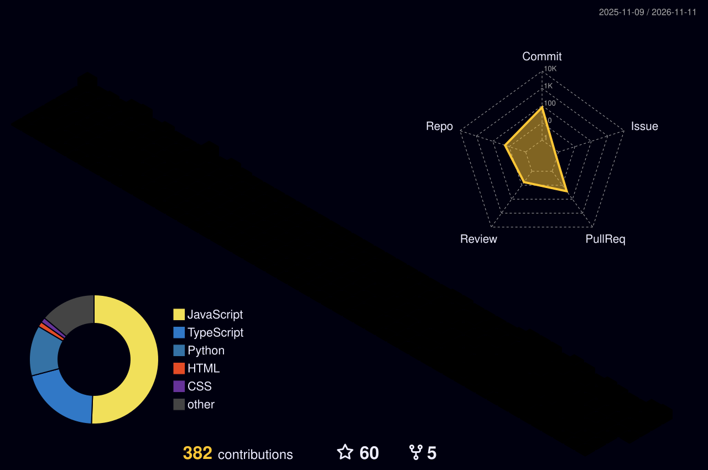

  
  

<h2 align="center">🛰️ The journey so far</h2>

<h2 align="center">⚡ What I build with</h2>

<b>Frontend</b> 

<b>Backend & data</b> 

<b>Cloud & DevOps</b> 

<b>AI engineering</b> 
  
  
  
  
  
  
  
  

<h2 align="center">🧠 Featured builds</h2>

<table>
<tr>
<td width="38%" align="center"></td>
<td>

### MetaWurks · retrieval & knowledge intelligence platform
A business AI hub that turns scattered documents into answers, with a multi-model router picking the right LLM for each task.

- **Hybrid retrieval**: BM25 + dense vectors fused with RRF, plus HyDE, query expansion and contextual compression
- **5,000+ documents** indexed on pgvector with sub-second retrieval
- **MCP-enabled agents** with live file sync and AI confidentiality detection
- **Private LLM deployments** for healthcare, finance and defence use cases

`LangGraph` `LangChain` `pgvector` `FastAPI` `Kubernetes`

</td>
</tr>
</table>

| 🏗️ [**AI System Design Simulator**](https://github.com/Badsha1996/ai-system-design-simulator) | 🗺️ [**Path Finder**](https://path-finder-next14.vercel.app) | 📊 [**Sorting Visualizer**](https://badsha1996.github.io/Sorting_visualizer/) |
|:---:|:---:|:---:|
|  |  |  |
| Build and stress-test architectures | Dijkstra and A*, visualized | Sorting performance in real time |
| `System design` `AI` | `Next.js` `Tailwind` | `JavaScript` |

| 🎨 **Virtual AI Painter** | 📚 **Doclin** | 📱 **QuilKalam** |
|:---:|:---:|:---:|
|  |  |  |
| Paint in the air with hand tracking | AI notes and Q&A for studying | Writing app for authors and readers |
| `Python` `OpenCV` `MediaPipe` | `TypeScript` `LLMs` | `React Native` `Expo` |

<h2 align="center">🏙️ My contributions, in 3D</h2>

<h2 align="center">📊 GitHub pulse</h2>

  
  

<h2 align="center">🌱 Beyond the code</h2>

- 🎓 **Teaching** future engineers at Newton School of Technology and Rishihood University, straight from production experience
- 🏆 **Mentoring** Team Think-X in the Smart India Hackathon 2026 Winner's Mentorship Program (AI for Bitcoin laundering detection)
- 🥇 Part of the **ZenseAI** team that won Zensar's Quarterly BU Award for Outstanding Contributing Team
- 🔬 **Exploring** graph-structured memory for AI with cue-based retrieval, inspired by cognitive science on context and recall

<h2 align="center">🤝 Let's build something</h2>

  
  
  
  

